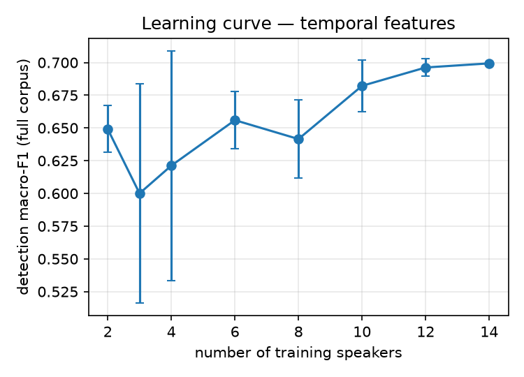
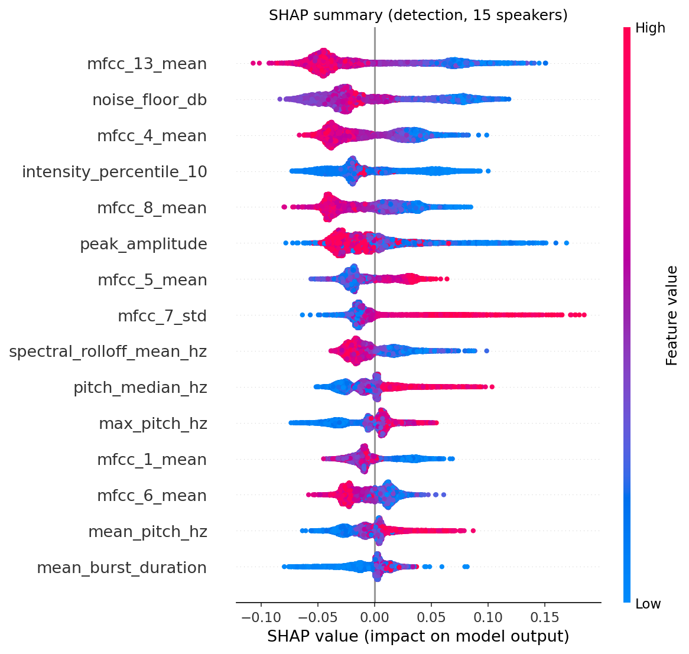

# Dysarthria Detection from Speech with Speaker-Independent Evaluation

A machine learning pipeline that detects **dysarthria** (a motor speech disorder) from short voice recordings
and attempts to estimate its **severity**. Built for my B.Sc. thesis in Software Engineering
(University of Europe for Applied Sciences, 2026).

It is designed as a **screening aid, not a diagnostic tool**, and the evaluation is deliberately strict:
every result below comes from **leave-one-speaker-out** cross-validation, so the model is always tested
on a person it has never heard before.

## Results

Dataset: the full [TORGO](https://www.cs.toronto.edu/~complingweb/data/TORGO/torgo.html) head-mic corpus,
**8,216 recordings from 15 speakers** (8 with dysarthria, 7 controls). Every recording is tested exactly once.

| Task | Model / features | Macro-F1 |
|---|---|---|
| Detection | SVM (RBF), all 90 features | 0.649 |
| Detection | SVM (RBF), 20 temporal features (pause and rhythm) | **0.699** |
| Detection, per speaker (majority vote) | SVM (RBF), temporal features | **0.80** (12 of 15 speakers correct) |
| Baselines | majority class / random | 0.389 / 0.46 to 0.50 |
| Severity (mild / moderate / severe) | SVM (RBF), all features | 0.162 |

**95% confidence interval** for the headline detection score (bootstrap over speakers, 2,000 resamples): **[0.53, 0.83]**.

### What the results show

- **Temporal features beat the full feature set.** Pause and rhythm measures alone outperform all 90 features
  combined. Adding spectral and voice-quality features dilutes the signal at this sample size,
  which argues for feature selection over concatenating everything.
- **The model is speaker-starved, not saturated.** The learning curve keeps rising up to the last speaker
  without plateauing. More speakers is the clearest path to better results.

  

- **There is a sex disparity.** Dysarthria in male speakers is detected far more reliably than in female speakers.
  The corpus contains only three female speakers with dysarthria, so this is a cohort limitation,
  but it would be a blocking issue for any real deployment.
- **Severity estimation does not work with this data.** With only two or three speakers per severity class,
  a speaker-independent model cannot learn the classes. I report this as a negative result rather than
  switching to a leaky utterance-level split that would produce a better-looking number.
- **The predictions are interpretable.** SHAP and feature importance show MFCC summaries and pause/intensity
  measures driving decisions, which matches the acoustic description of dysarthric speech.

  

## How it works

```
audio (.wav) -> CLVAD feature engine (+ speech_mfcc extension) -> per-recording feature records
            -> feature matrix (90 features, 4 clinical domains)
            -> SVM / Random Forest, leave-one-speaker-out CV
            -> metrics, ablation, speaker-level evaluation, SHAP, bootstrap CI, learning curve
```

Feature extraction uses **CLVAD**, an acoustic analysis engine developed by my collaborator Iftakhar
for vocal analytics, which I adapted to pathological speech. My contributions:

- **`engine_extension/speech_mfcc.py`**: a new engine analytic producing 28 MFCC and zero-crossing-rate features,
  with tests (`test_speech_mfcc.py`) and the patch that registers it in the engine (`speech_mfcc.patch`)
- **`pipeline/`**: the full evaluation pipeline
  - `build_features.py`, `assemble_csv.py`: feature extraction and matrix assembly, including the TORGO severity mapping
  - `train_baselines.py`: SVM and Random Forest with leave-one-speaker-out CV, per-domain ablation, SHAP
  - `speaker_level_eval.py`: speaker-level results (majority vote and per-speaker aggregation)
  - `rigour_analysis.py`, `learning_curve.py`: trivial baselines, bootstrap confidence intervals, learning curve
  - `verify_full_coverage.py`: checks that every recording is held out and tested exactly once
  - `make_figures.py`: confusion matrices, feature importance and SHAP plots

## Running it

Two external dependencies are **not** included in this repository:

- **TORGO corpus** (about 18 GB): available from the University of Toronto for research use.
- **CLVAD engine**: a separate repository. Apply `engine_extension/speech_mfcc.patch` to it before running.

```bash
pip install -r requirements.txt
python -m nltk.downloader cmudict

python run_experiment.py --engine-root ../creative-analysis-engine --torgo-root ../TORGO --shap
```

The classical models are CPU-only and cheap to train. The resulting metrics from the full run are in `results/`
and all figures are in `figures/`.

## Limitations

- 15 speakers is small, and the confidence interval is wide.
- Jitter, shimmer, HNR and formants are computed with librosa/LPC heuristics, not clinical-grade Praat measurements.
- Only dysarthria is evaluated; there is no cross-corpus test (UASpeech would be the natural next step).

## Tech

Python, scikit-learn, librosa, SHAP, pandas, NumPy, Matplotlib
